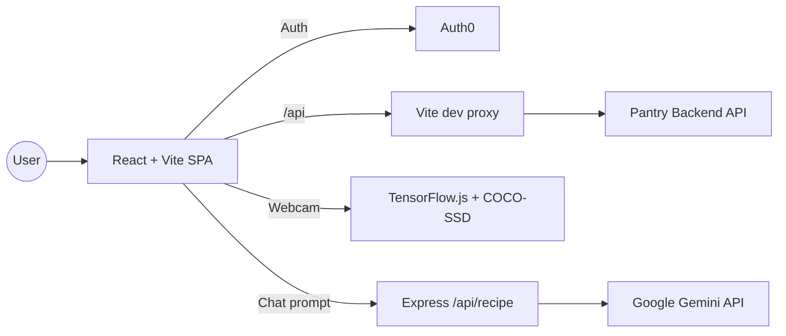

# Aggie Pantry

Full-stack inventory and checkout experience for Aggie food pantry,
with shopper views, admin workflows, and AI-assisted recipe suggestions.

## Links
- Devpost: https://devpost.com/software/the-aggie-pantry
- Live: https://theaggiepantry.vercel.app
- Pitch(with demo): https://pitch.com/v/aggie-pantry-knpg2m

## Features
- Role-based access (shopper vs. admin) with Auth0 authentication.
- Pantry inventory browsing with filtering and search.
- Admin dashboard for inventory, suppliers, volunteers, and distribution.
- Checkout flow with QR scanning and item tracking.
- On-device object detection for faster item intake and validation.
- Recipe chatbot powered by Gemini for meal ideas from pantry items.

## Tech Stack
- Frontend: React, TypeScript, Vite, React Router, Tailwind CSS, Zustand.
- Auth: Auth0 (JWT-based API access).
- AI/ML: Gemini (chatbot), TensorFlow.js + COCO-SSD (object detection).
- QR: `@yudiel/react-qr-scanner`, `react-qr-code`.
- Charts: Recharts.
- Backend: Express (recipe endpoint), external REST API via Vite proxy.

## Technical Design Diagram


## Getting Started
### Prerequisites
- Node.js 18+
- npm

### Install
```bash
npm install
```

### Run (dev)
```bash
npm run dev
```

### Build
```bash
npm run build
```

## Configuration
- Auth0 config lives in `src/auth/Auth0ProviderWithNavigate.tsx`.
- API proxy target is set in `vite.config.ts` under `server.proxy`.
- Gemini API key is required for the recipe endpoint in `src/pages/api/recipe.ts`:
  - `GEMINI_API_KEY=...`

## Project Structure
```
src/
  auth/            Auth0 provider wrapper
  components/      Reusable UI, CV, and chatbot components
  context/         Global app state + API calls
  pages/           Shopper + admin routes
  data/            Mock data for suppliers/volunteers
```

## Scripts
- `npm run dev` - start the Vite dev server
- `npm run build` - build for production
- `npm run preview` - preview the production build
- `npm run lint` - run ESLint
